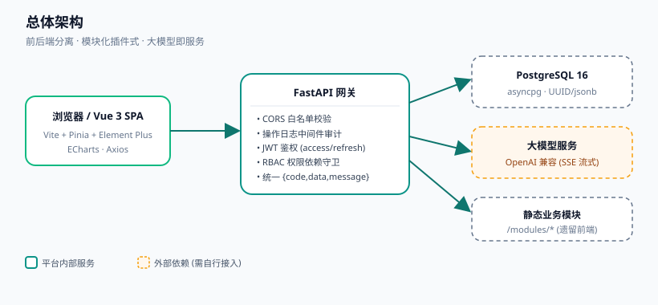
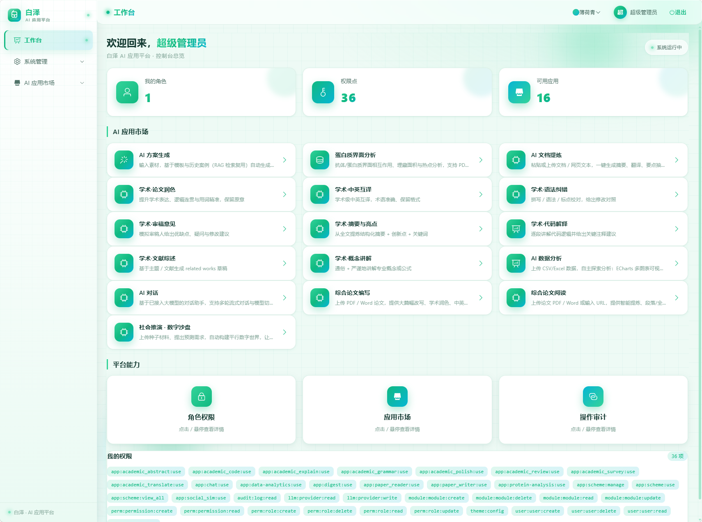
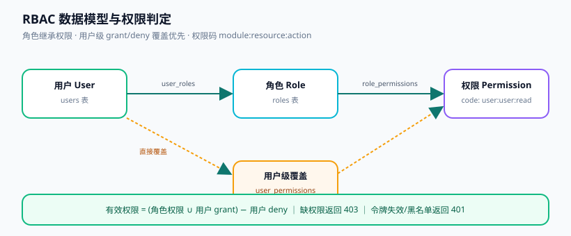
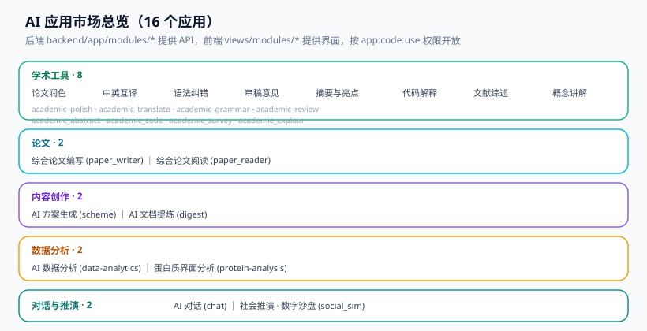
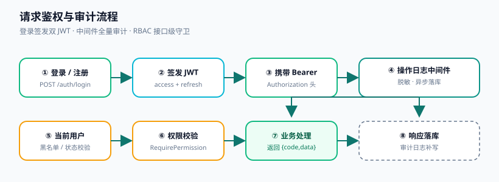
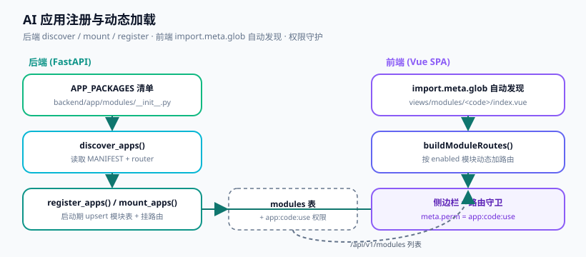
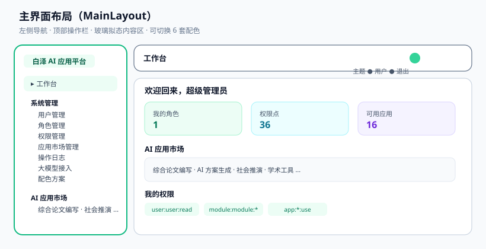
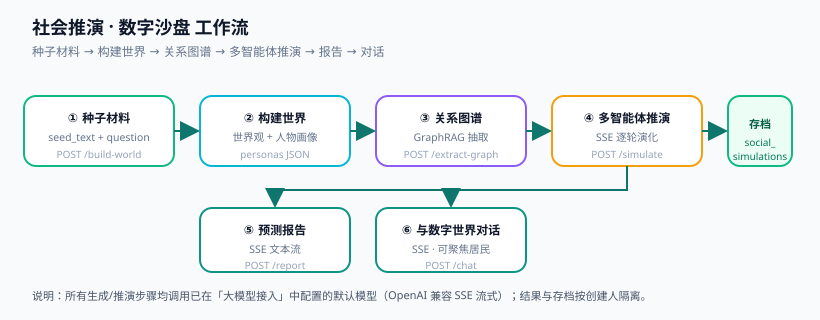

# 白泽 AI 应用平台（Baize Platform）

基于 **Vue 3 + FastAPI + PostgreSQL** 的前后端分离、模块化插件式 **AI 应用开发与运行平台**。
内置三大核心治理能力（用户、权限、模块），并提供「大模型接入」「配色方案」等系统级管理能力；以「模块注册制」纳管 16 个开箱即用的 AI 应用（学术工具、论文读写、方案生成、文档提炼、数据分析、蛋白质分析、AI 对话、社会推演等）。

> 平台自身不直连大模型厂商，而是通过统一的 **OpenAI 兼容** 接口接入任意大模型服务（OpenAI / DeepSeek / 通义千问 / 本地 vLLM / Ollama 等），所有 AI 能力均共享同一套接入配置。

---

## 功能特性速览

- 🧩 **模块化插件式架构**：AI 应用 = 后端应用包（`backend/app/modules/<pkg>`）+ 前端视图（`frontend/src/views/modules/<code>/index.vue`），启动期自动发现、注册、挂载。
- 🔐 **RBAC 细粒度权限**：`module:resource:action` 权限码，角色继承 + 用户级 `grant/deny` 覆盖，接口级与路由级双重守卫。
- 🪪 **双 JWT 鉴权**：Access（15 min）+ Refresh（7 d），刷新令牌可吊销（黑名单），登录失败自动锁定。
- 📝 **全量操作审计**：中间件自动记录所有请求（敏感字段脱敏），可追溯每一步关键操作。
- 🤖 **大模型即服务**：系统级「大模型接入」管理，支持多服务商、连通性测试、默认模型，AI 应用零改造切换底座。
- 🎨 **多主题配色**：内置 6 套配色（薄荷青 / 海洋蓝 / 紫罗兰 / 玫红 / 琥珀金 / 暗夜），管理员可设定平台默认值，用户可自定义。
- 📊 **16 个 AI 应用**：覆盖学术写作、论文处理、方案/文档生成、数据分析与可视化、蛋白质界面分析、对话与社会推演。
- 🧱 **统一响应与数据校验**：Pydantic v2 强校验，统一 `{ code, data, message }` 信封，业务规则不信任前端。

---

## 总体架构



| 层 | 技术选型 |
|----|----------|
| 前端 | Vue 3.4 + Vite 5 + TypeScript 5 + Pinia 2 + Vue Router 4 + Element Plus 2 + Axios + **ECharts 6 / echarts-gl / xlsx** |
| 后端 | FastAPI 0.115 + SQLAlchemy 2.0（async）+ Pydantic v2 + PyJWT + bcrypt + httpx |
| 数据库 | PostgreSQL 16（`pgcrypto` 扩展；UUID 主键、ENUM、`jsonb`） |
| 大模型 | 任意 OpenAI 兼容服务（`/v1/chat/completions`、`/v1/models`），SSE 流式调用 |

**部署拓扑要点**
- 前端开发端口 `5173`，通过 Vite 代理把 `/api` 与 `/modules` 转发到后端 `127.0.0.1:8000`。
- 后端 `GET /health` 用于健康检查；业务 API 统一前缀 `/api/v1`。
- 根目录 `modules/` 下的遗留静态前端（如蛋白质分析、数据分析的历史版本）由 `app.mount("/modules", StaticFiles(...))` 托管，与 API 前缀 `/api/v1/modules/*` 互不冲突。

## 界面预览

· [界面预览](docs/UI.md)




其他参考

· [界面预览](docs/UI.md)

## 目录结构

```
Baize/
├── docs/                       # 设计文档（架构/数据库/API/前端/模块规范）+ assets/ 示意图
├── backend/
│   ├── app/
│   │   ├── core/               # config / database / security / deps / llm / logging
│   │   ├── models/__init__.py  # 17 张数据表 ORM 定义
│   │   ├── routers/            # auth / users / rbac / modules / audit / llm / theme
│   │   ├── modules/            # 16 个 AI 应用（每个含 manifest + routes）
│   │   │   ├── academic_shared/# 学术工具共享工厂（8 个学术应用共用）
│   │   │   ├── social_sim/     # 社会推演 · 数字沙盘
│   │   │   ├── scheme/ digest/ paper_writer/ paper_reader/ chat/
│   │   │   └── data_analytics/ protein_analysis/
│   │   ├── schemas/            # Pydantic 模型 + 统一响应信封
│   │   └── main.py             # 应用入口：中间件、路由、生命周期
│   ├── sql/init.sql            # PostgreSQL 初始 DDL（11 张核心表 + 枚举 + 种子）
│   ├── scripts/scan_modules.py # 手动扫描并注册 AI 应用（可选）
│   ├── migrate_add_graph_json.py # 社会推演 graph_json 字段迁移
│   ├── requirements.txt  .env.example  run.bat
├── frontend/
│   └── src/
│       ├── api/ router/ store/ layouts/ views/ components/ utils/
│       ├── views/modules/      # 各 AI 应用前端视图（与后端 code 对应）
│       └── views/system/        # 系统管理界面（用户/角色/权限/模块/审计/LLM/主题）
└── modules/                    # 遗留静态业务模块（scheme / protein-analysis / data-analytics）
```

---

## 三大核心治理能力

### 1. 用户管理（`/api/v1/users`）
注册、登录、个人信息维护；账号状态 `active / disabled / locked` 控制（启用 / 禁用 / 锁定 / 解锁）；软删除（`deleted_at`）+ 最后登录时间记录；角色分配（`PUT /users/{id}/roles`）。

### 2. 权限管理（`/api/v1/roles`、`/api/v1/permissions`）
基于角色的 RBAC：角色定义、细粒度权限点（`module:resource:action`）、权限树（按 `module` 分组）、角色授权。用户级 `UserPermission` 支持 `grant / deny` 覆盖，且**覆盖优先于角色权限**。



### 3. 模块管理（`/api/v1/modules`）
AI 应用与业务模块的注册、启用 / 禁用 / 停用 / 重启、配置读写、依赖查看与注销。模块以 `code` 唯一标识，注册时声明 `api_prefix` 与 `use_permission`。

### 4. 系统级扩展能力
- **大模型接入管理**（`/api/v1/llm`）：新增 / 更新 / 删除接入，连通性测试，设置默认模型；AI 应用统一调用默认模型。
- **配色方案管理**（`/api/v1/theme`）：设置平台默认主题；未登录也可读取默认配色（`GET /theme/default` 公开）。

---

## AI 应用市场（16 个应用）



> 每个应用的使用由权限码 `app:<code>:use` 守护；`super_admin` 默认拥有全部应用的使用权。应用视图由前端 `import.meta.glob` 自动发现并挂载为动态路由，从侧边栏「AI 应用市场」进入。

### 学术工具（8 个，共用工厂 `academic_shared`）
上传 / 粘贴文本，调用对应系统提示词，SSE 流式返回结果。均对外暴露 `POST /run` 与 `GET /health`。

| 应用 | code | 能力 |
|------|------|------|
| 学术·论文润色 | `academic_polish` | 提升学术表达、逻辑连贯与用词精准，保留原意 |
| 学术·中英互译 | `academic_translate` | 学术级中英互译，术语准确、保留格式 |
| 学术·语法纠错 | `academic_grammar` | 拼写 / 语法 / 标点校对，给出修改对照 |
| 学术·审稿意见 | `academic_review` | 模拟审稿人给出优缺点、疑问与修改建议 |
| 学术·摘要与亮点 | `academic_abstract` | 从全文提炼结构化摘要 + 创新点 + 关键词 |
| 学术·代码解释 | `academic_code` | 逐段讲解代码逻辑并给出关键注释建议 |
| 学术·文献综述 | `academic_survey` | 基于主题 / 文献生成 related works 草稿 |
| 学术·概念讲解 | `academic_explain` | 通俗 + 严谨地讲解专业概念或公式 |

### 论文（2 个）
- **综合论文编写**（`paper_writer`）：上传 PDF / Word（≤30MB），提供大篇幅改写、学术润色、中英互译、内容提炼、结构重组、参考文献整理。端点：`POST /upload`、`POST /run`（SSE）。
- **综合论文阅读**（`paper_reader`）：上传 PDF / Word 或输入 URL，提供智能提炼、段落 / 全文翻译、核心观点脑图、摘要生成与交互问答。端点：`POST /upload`、`POST /url`、`POST /run`、`POST /ask`（SSE）。

### 内容创作（2 个）
- **AI 方案生成**（`scheme` v2.0.0）：输入素材 → 基于模板与历史案例（RAG 检索复用）自动生成完整方案，支持导出 Markdown / Word / HTML。端点：模板 / 案例 CRUD、`POST /search`（召回）、`POST /generate`（SSE）、`POST /export`、`/projects` 方案库。管理员持 `app:scheme:view_all` 可见全部方案。
- **AI 文档提炼**（`digest`）：粘贴或上传文档 / 网页文本，一键生成摘要、翻译、要点抽取与脑图大纲，支持复制与导出。端点：`POST /refine`（`task ∈ summary|translate|extract|outline`，SSE）。

### 数据分析（2 个）
- **AI 数据分析**（`data-analytics`）：上传 CSV / Excel，ECharts 多图表可视化、统计与相关性、资助专项分析，并由 AI 进行科学解读与对话问答。端点：`GET /datasets`、`POST /insights`、`POST /ai/chat`（SSE）。
- **蛋白质界面分析**（`protein-analysis`）：抗体 / 蛋白质界面相互作用、埋藏面积与热点分析，支持 PDB / CIF 结构加载与 3D 可视化。端点：`POST /analyze`。

### 对话与推演（2 个）
- **AI 对话**（`chat`）：基于已接入大模型的多轮流式对话、模型切换；对话补全由系统端点 `POST /api/v1/llm/chat`（守卫 `app:chat:use`）提供。
- **社会推演 · 数字沙盘**（`social_sim`）：上传种子材料、提出预测需求，自动构建平行数字世界，让一群具备独立人格的智能体自由演化，推演未来走向并生成预测报告。详见下文。

---

## 关键机制

### 鉴权与审计流程


1. 登录 `POST /api/v1/auth/login` 返回 `access_token` + `refresh_token`（bcrypt 密码哈希，密码策略 ≥8 位含大小写 / 数字 / 特殊字符）。
2. 业务请求在 `Authorization: Bearer <access>` 头携带令牌；前端响应拦截器在 access 过期时自动用 refresh 换发。
3. `OperationLogMiddleware` 中间件对所有请求脱敏（剔除 password / token / secret 等键）后异步落库 `operation_logs`。
4. `get_current_user` 校验令牌有效性、黑名单、账号状态；`RequirePermission(code)` 做接口级权限校验（缺权限返回 403）。
5. 统一响应信封：`{ "code": 0, "data": ..., "message": "ok" }`，非 0 即业务错误。

### 模块注册与动态加载


- 后端 `APP_PACKAGES`（`backend/app/modules/__init__.py`）列出全部应用；`discover_apps()` 读取各包 `MANIFEST` + `router`。
- 启动生命周期（`lifespan`）中：`Base.metadata.create_all` 自动建表 → `_seed_superadmin()` 播种管理员与内置权限 → `register_apps(db)` 把应用 upsert 进 `modules` 表、写入 `app:<code>:use` 权限并授予 `super_admin` → `mount_apps()` 挂载路由。
- 前端 `buildModuleRoutes()` 依据 `import.meta.glob('../views/modules/*/index.vue')` 自动发现视图，按 `enabled` 模块生成动态路由，`meta.perm = app:<code>:use` 守护。
- 手动注册脚本（可选）：`python backend/scripts/scan_modules.py`，等价于上面的 `register_apps`。

### 安全要点
CORS 白名单（默认 `http://localhost:5173`）、登录失败锁定（`MAX_LOGIN_ATTEMPTS=5`，锁定 `LOCK_MINUTES=15`）、最小权限、参数化查询、软删除 + 审计留痕、刷新令牌黑名单。

---

## 快速开始

### 环境与依赖
- Node.js ≥ 18（前端）
- Python ≥ 3.10（后端；推荐 3.11+）
- PostgreSQL 16（需启用 `pgcrypto` 扩展）

### 1. 后端
```bash
cd backend
python -m venv .venv && source .venv/bin/activate   # Windows: .venv\Scripts\activate
pip install -r requirements.txt
cp .env.example .env                                 # 填写数据库连接与 SECRET_KEY

# 首次启动：lifespan 会自动 create_all 建表 + 播种管理员 + 注册 AI 应用
uvicorn app.main:app --reload --port 8000
# 或使用项目自带脚本（Windows）：run.bat
```
- 默认管理员：**`admin` / `Admin@123456`**（首次启动自动播种，幂等补齐）。
- 健康检查：`GET http://127.0.0.1:8000/health` → `{ "code": 0, "message": "ok" }`。

> 生产环境建议使用 Alembic 迁移代替 `create_all`；`backend/sql/init.sql` 提供最初的 11 张核心表 DDL 与枚举、种子，`backend/migrate_add_graph_json.py` 为后续新增的社会推演 `graph_json` 字段迁移脚本。

### 2. 前端
```bash
cd frontend
npm install
npm run dev      # http://localhost:5173 （Vite 代理 /api、/modules 到后端 8000）
```

### 3. 配置大模型（使用任何 AI 功能前必做）
进入 **系统管理 → 大模型接入**，新增一个 OpenAI 兼容服务（填写 `base_url`、`api_key`、默认 `model`），点击「连通性测试」通过后设为默认。未配置默认模型时，AI 应用的生成类接口会返回 `code: 404`。

### 4. （可选）配色方案
进入 **系统管理 → 配色方案**，选择并保存平台默认主题；登录后右上角可随时切换个人主题。

---

## 基本使用指引



1. **登录**：浏览器打开 `http://localhost:5173`，使用 `admin / Admin@123456` 登录；未登录访问受保护路由会自动跳转登录页。
2. **工作台**：登录后进入「工作台」，展示我的角色 / 权限点 / 可用应用统计，并提供 AI 应用市场快捷入口与「我的权限」标签。
3. **系统管理**（按权限可见）：
   - **用户管理**：新建 / 编辑 / 启用禁用锁定用户、分配角色。
   - **角色管理**：新建角色、配置角色权限点。
   - **权限管理**：查看按模块分组的权限树。
   - **应用市场管理**：查看已注册应用、启停与配置（新增 AI 应用需先在此启用并授予使用权限）。
   - **操作日志**：按用户 / 模块 / 方法 / 路径 / 时间检索审计记录。
   - **大模型接入**：管理大模型服务商与默认模型（AI 能力的基石）。
   - **配色方案**：设定平台默认主题。
4. **使用 AI 应用**：从侧边栏「AI 应用市场」进入对应应用，按界面提示输入素材 / 上传文件，多数生成类任务以流式（打字机）方式实时返回结果，可复制或导出。

### 社会推演 · 数字沙盘 使用流程


1. **构建世界**（`POST /build-world`）：粘贴种子材料（背景设定 / 群体描述）并提出预测需求，由大模型抽取世界观与人物画像（`personas`）。
2. **关系图谱**（`POST /extract-graph`）：GraphRAG 式抽取实体 / 关系，返回节点与边（前端以力导向图预览）。
3. **多智能体推演**（`POST /simulate`，SSE）：注入「上帝视角」事件，多个具备独立人格的智能体并行演化，逐轮返回动作与状态。
4. **预测报告**（`POST /report`，SSE）：汇总推演过程生成 Markdown 预测报告。
5. **与数字世界对话**（`POST /chat`，SSE）：针对特定居民（`focus`）深入追问。
6. **存档**：以上结果保存在 `social_simulations` 表，支持 `/projects` 列表、详情、保存、更新与删除（按创建人隔离）。

---

## API 速查

统一前缀 `/api/v1`；除下列公开端点外均需 `Authorization: Bearer <access>`。

**公开端点**
| 方法 | 路径 | 说明 |
|------|------|------|
| POST | `/auth/register` | 注册 |
| POST | `/auth/login` | 登录（返回双令牌） |
| POST | `/auth/refresh` | 用 refresh 换 access |
| POST | `/auth/logout` | 吊销 refresh（进黑名单） |
| GET | `/theme/default` | 平台默认配色（登录前后均可） |
| GET | `/health` | 健康检查（根路径） |

**主要受保护端点（节选）**
| 域 | 代表端点 | 守卫权限 |
|----|----------|----------|
| 用户 | `GET/POST /users`、`PATCH /users/{id}`、`POST /users/{id}/{enable,disable,lock,unlock}` | `user:user:*` |
| 角色 | `GET/POST /roles`、`PUT/GET /roles/{id}/permissions` | `perm:role:*` |
| 权限 | `GET /permissions`、`GET /permissions/tree` | `perm:permission:read` |
| 模块 | `GET /modules`、`POST /modules/register`、`POST /modules/{code}/{enable,disable,stop}` | `module:module:*` |
| 审计 | `GET /audit/logs` | `audit:log:read` |
| 大模型 | `GET/POST /llm/providers`、`POST /llm/providers/{id}/test`、`POST /llm/chat` | `llm:provider:*` / `app:chat:use` |
| 主题 | `PUT /theme/default` | `theme:config` |
| AI 应用 | `/modules/<code>/run`、`/generate`、`/simulate` … | `app:<code>:use` |

完整接口定义见 [`docs/API.md`](docs/API.md)；架构、数据库、前端、模块规范见 `docs/` 下对应文档。

---

## 数据库

- 启动期 `Base.metadata.create_all` 自动创建 **17 张数据表**：
  `users`、`roles`、`permissions`、`user_roles`、`role_permissions`、`user_permissions`、`modules`、`module_dependencies`、`module_configs`、`operation_logs`、`token_blacklist`、`llm_providers`、`site_settings`、`scheme_templates`、`scheme_cases`、`scheme_projects`、`social_simulations`。
- `backend/sql/init.sql` 提供最初的 11 张核心表 DDL、3 个 ENUM（`user_status` / `module_status` / `perm_effect`）与超管角色种子，可作为生产初始化参考。
- 表结构说明见 [`docs/DATABASE.md`](docs/DATABASE.md)。

---

## 开发与运维

- **后端语法校验**（受管 Python）：`python -m py_compile backend/app/**/*.py`
- **前端类型检查与构建**：`npm run build`（即 `vue-tsc --noEmit && vite build`）
- **手动注册 AI 应用**：`python backend/scripts/scan_modules.py`
- **新增 AI 应用**：在 `backend/app/modules/<pkg>/` 下提供 `MANIFEST` 与 `router`，并在 `APP_PACKAGES` 登记；在前端 `frontend/src/views/modules/<code>/index.vue` 提供视图（自动发现）。规范见 [`docs/MODULE_SPEC.md`](docs/MODULE_SPEC.md)。

---

## 文档索引

- [架构设计](docs/ARCHITECTURE.md) · [数据库](docs/DATABASE.md) · [API 定义](docs/API.md) · [前端](docs/FRONTEND.md) · [模块规范](docs/MODULE_SPEC.md) · [界面预览](docs/UI.md)

> 本文档依据当前代码实现整理；若实现有更新，请以代码与 `docs/` 设计文档为准。
